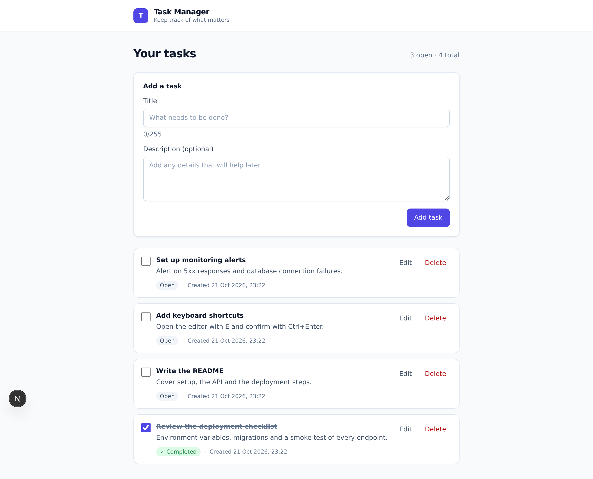

# Task Manager

A full-stack task manager built with Next.js, TypeScript, Tailwind CSS and PostgreSQL. Create, edit, complete and delete tasks, with the list kept in sync by a small REST API backed by a Neon Postgres database.

**[Live demo](https://task-manager-mu-ashy.vercel.app)** · **[Source](https://github.com/Mujadid2001/task-manager)**



## Features

- **Create tasks** with a title and an optional description, validated on the client and again on the server with the same Zod schema.
- **Edit in place** — the row becomes a form, `Escape` cancels, and the title is focused on open.
- **Complete tasks** with a checkbox that updates optimistically and rolls back if the request fails.
- **Delete with confirmation** in a native modal dialog; focus starts on _Cancel_.
- **Clear state handling** for loading, empty, and error states, with a retry button.
- **Accessible by construction** — real labels, an `aria-live` counter, keyboard-operable controls, focus rings and non-colour status cues.
- **Responsive** layout that stays readable from a 360px phone to a desktop.

## Tech stack

| Layer      | Choice                                                          |
| ---------- | --------------------------------------------------------------- |
| Framework  | Next.js 16 (App Router, Route Handlers)                         |
| Language   | TypeScript (strict)                                             |
| UI         | React 19, Tailwind CSS 4                                        |
| Validation | Zod 4                                                           |
| Database   | PostgreSQL on Neon, accessed through `@neondatabase/serverless` |
| Testing    | Vitest                                                          |
| Tooling    | ESLint, Prettier, `tsc --noEmit`                                |
| Hosting    | Vercel                                                          |

## Getting started

### Prerequisites

- Node.js 20.9 or newer
- A PostgreSQL database — [Neon](https://neon.tech) has a free tier
- npm

### Installation

```bash
git clone https://github.com/Mujadid2001/task-manager.git
cd task-manager
npm install
```

### Configuration

Copy the template and fill in the database connection string:

```bash
cp .env.example .env.local
```

| Variable       | Required | Description                                                                           |
| -------------- | -------- | ------------------------------------------------------------------------------------- |
| `DATABASE_URL` | yes      | Pooled Postgres connection string. Use the `-pooler` host for serverless deployments. |

### Database

Create the table, indexes and the `updated_at` trigger:

```bash
npm run db:setup
```

The script applies `db/schema.sql` one statement at a time, because the Neon HTTP driver accepts a single statement per request. The schema is idempotent, so it is safe to run again.

### Development

```bash
npm run dev
```

Open [http://localhost:3000](http://localhost:3000).

## Database schema

`db/schema.sql` is the single source of truth.

### `tasks`

| Column        | Type           | Constraints                              | Notes                                             |
| ------------- | -------------- | ---------------------------------------- | ------------------------------------------------- |
| `id`          | `UUID`         | primary key, `DEFAULT gen_random_uuid()` |                                                   |
| `title`       | `VARCHAR(255)` | `NOT NULL`                               | Trimmed and required.                             |
| `description` | `TEXT`         | nullable                                 | An empty description is stored as `NULL`.         |
| `completed`   | `BOOLEAN`      | `NOT NULL DEFAULT FALSE`                 |                                                   |
| `created_at`  | `TIMESTAMPTZ`  | `NOT NULL DEFAULT NOW()`                 | Used for ordering.                                |
| `updated_at`  | `TIMESTAMPTZ`  | `NOT NULL DEFAULT NOW()`                 | Maintained by the `tasks_set_updated_at` trigger. |

Indexes: `tasks_created_at_idx` on `created_at DESC`, `tasks_completed_idx` on `completed`.

Tasks are listed open-first and newest-first, which matches the index.

## API reference

All responses use a consistent envelope:

```json
{ "data": ... }
```

```json
{ "error": { "code": "VALIDATION_ERROR", "message": "...", "details": [] } }
```

`details` is present only for validation errors and contains `{ "path", "message" }` entries.

### Task object

```json
{
  "id": "3b36ba11-d9e8-4056-a7d7-7a36344865f1",
  "title": "Write the README",
  "description": "Cover setup and deployment.",
  "completed": false,
  "createdAt": "2026-10-21T18:14:24.815Z",
  "updatedAt": "2026-10-21T18:14:33.140Z"
}
```

### `GET /api/tasks`

Returns every task, open tasks first, newest first within each group.

```bash
curl https://task-manager-mu-ashy.vercel.app/api/tasks
```

`200 OK`

### `POST /api/tasks`

| Field         | Type      | Required | Rules                                       |
| ------------- | --------- | -------- | ------------------------------------------- |
| `title`       | `string`  | yes      | Trimmed, 1–255 characters.                  |
| `description` | `string`  | no       | Up to 5000 characters; `""` becomes `null`. |
| `completed`   | `boolean` | no       | Defaults to `false`.                        |

```bash
curl -X POST https://task-manager-mu-ashy.vercel.app/api/tasks \
  -H 'Content-Type: application/json' \
  -d '{"title":"Write the README","description":"Cover setup and deployment."}'
```

`201 Created` — returns the stored task.

### `PUT /api/tasks/:id`

Accepts any subset of `title`, `description` and `completed`, but at least one field must be present.

```bash
curl -X PUT https://task-manager-mu-ashy.vercel.app/api/tasks/<id> \
  -H 'Content-Type: application/json' \
  -d '{"completed":true}'
```

`200 OK` — returns the updated task. `404 Not Found` if the id does not exist.

### `DELETE /api/tasks/:id`

```bash
curl -X DELETE https://task-manager-mu-ashy.vercel.app/api/tasks/<id>
```

`200 OK` — returns `{ "id": "...", "deleted": true }`. `404 Not Found` if the id does not exist.

### Error codes

| Code               | Status | Meaning                                              |
| ------------------ | ------ | ---------------------------------------------------- |
| `VALIDATION_ERROR` | 400    | Body or id failed schema validation.                 |
| `INVALID_JSON`     | 400    | The request body is not valid JSON.                  |
| `NOT_FOUND`        | 404    | No task exists with that id.                         |
| `DATABASE_ERROR`   | 500    | The database is unreachable. Details are not leaked. |
| `INTERNAL_ERROR`   | 500    | Unexpected failure. Details are logged server-side.  |

## Project structure

```
app/
  api/tasks/route.ts          GET and POST handlers
  api/tasks/[id]/route.ts     PUT and DELETE handlers
  layout.tsx                  Root layout and metadata
  page.tsx                    The single page
components/
  task/                       Task manager, list, row, forms, dialog, states
  ui/                         Button, input and textarea primitives
db/
  schema.sql                  Table, indexes and trigger
lib/
  api.ts                      Response envelope and error mapping
  api-client.ts               Typed fetch wrapper used by the client
  db.ts                       Neon client, lazy init and retry wrapper
  retry.ts                    Transient-error detection and backoff
  sort.ts                     Client-side ordering matching the SQL
  tasks.ts                    The queries
  validators.ts               Zod schemas shared by client and server
  *.test.ts                   Unit tests
scripts/
  db-setup.ts                 Applies db/schema.sql
docs/
  screenshot.png
```

## Scripts

| Script                 | Description                               |
| ---------------------- | ----------------------------------------- |
| `npm run dev`          | Start the development server.             |
| `npm run build`        | Create a production build.                |
| `npm run start`        | Serve the production build.               |
| `npm run lint`         | Run ESLint.                               |
| `npm run typecheck`    | Type-check with `tsc --noEmit`.           |
| `npm run test`         | Run the Vitest suite once.                |
| `npm run test:watch`   | Run Vitest in watch mode.                 |
| `npm run verify`       | Lint, type-check and test in one command. |
| `npm run format`       | Format with Prettier.                     |
| `npm run format:check` | Check formatting without writing.         |
| `npm run db:setup`     | Apply `db/schema.sql` to `DATABASE_URL`.  |

## Testing

```bash
npm run test
```

The suite covers the validation contract, the API error envelope, the retry policy, the client-side sort and every task query. Queries are tested against a fake Neon client injected through the existing `setSql` seam, so the tests assert the generated SQL and bind parameters without needing a database.

The interaction flows — create, edit, complete, delete and long-title wrapping — were exercised end to end in a headless browser against the running app.

## Deployment

The project is deployed on Vercel with a Neon Postgres database provisioned from the Vercel Marketplace.

### One-click deploy

[](https://vercel.com/new/clone?repository-url=https%3A%2F%2Fgithub.com%2FMujadid2001%2Ftask-manager)

Create a Neon database when prompted, or add the integration afterwards; either way `DATABASE_URL` is injected automatically.

### Manual deploy

1. Import the repository in Vercel. The Next.js preset is detected automatically.
2. Add the Neon integration from the Vercel Marketplace, or set `DATABASE_URL` yourself under **Project → Settings → Environment Variables**.
3. Run `npm run db:setup` once against the production database.
4. Deploy. Every push to `main` then produces a production deployment, and every pull request a preview.

## Git workflow

Work lands on `main` through pull requests, one branch per change:

```
<type>/<short-description>
```

Types follow [Conventional Commits](https://www.conventionalcommits.org/): `feat`, `fix`, `refactor`, `test`, `docs`, `chore`.

Commits are atomic — a change and its motivation, not a checkpoint — and each PR explains what changed, why, and how it was verified. Branches are deleted after merging.

```bash
git checkout -b feat/my-change
# commit, then
git push -u origin feat/my-change
gh pr create --fill
gh pr merge --merge --delete-branch
```

## License

[MIT](LICENSE)
